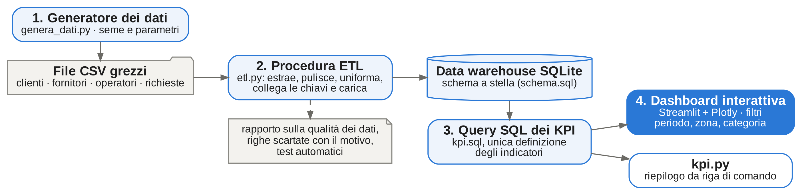

# CasaLampo · analisi dei dati per una startup di servizi on-demand

Prototipo realizzato per il project work del corso di laurea L-31 (traccia PW 21,
*Progettare l'analisi dei dati per una startup digitale di servizi on-demand*).

CasaLampo è una startup **di fantasia** che, tramite app, raccoglie richieste di
intervento tecnico a domicilio (idraulica, elettricità, caldaie, climatizzazione,
serrature, elettrodomestici) e le assegna a un'impresa partner (fornitore) e a un
tecnico (operatore). Tutti i dati sono inventati, generati per l'occasione, e non
contengono informazioni personali.

Il prototipo comprende:

1. un **generatore di dati** sintetici ma realistici (CSV, 300–600 record per tipologia);
2. una **procedura ETL** che legge i CSV, li pulisce, li uniforma e li carica in un
   **data warehouse SQLite** organizzato a stella;
3. le **interrogazioni SQL** degli indicatori principali;
4. una **dashboard interattiva** in Streamlit con filtri per periodo, zona e categoria.



## Avvio rapido (circa 5 minuti)

Serve Python 3.10 o successivo. Dalla cartella del progetto:

```bash
python -m venv .venv
.venv\Scripts\activate            # Windows
# source .venv/bin/activate       # macOS / Linux
pip install -r requirements.txt

python esegui_tutto.py            # genera i dati, esegue l'ETL, calcola i KPI, lancia i test
streamlit run dashboard/app.py    # apre la dashboard nel browser (http://localhost:8501)
```

I singoli passi si possono eseguire anche separatamente:

```bash
python src/genera_dati.py         # 1. dati inventati in data/raw/
python src/etl.py                 # 2. data warehouse in data/dw/casalampo_dw.sqlite
python src/kpi.py                 # 3. indicatori principali a terminale
python -m unittest discover -s tests -v   # controlli automatici
```

La cartella `data/` contiene già i file prodotti con il seme 42, cioè gli stessi
descritti nella relazione: la dashboard può quindi essere aperta anche subito.

## Struttura

```
src/comune.py        costanti condivise (zone, categorie, soglia di ritardo, percorsi, calendario)
src/genera_dati.py   generatore dei dati inventati
src/etl.py           procedura di estrazione, trasformazione e caricamento
src/kpi.py           esecuzione delle query degli indicatori
sql/schema.sql       schema a stella (tabelle, vincoli, indici, vista analitica)
sql/kpi.sql          query SQL degli indicatori, con filtri parametrici
dashboard/app.py     dashboard Streamlit
tests/               test automatici (unittest)
data/raw/            CSV generati + anomalie_introdotte.json
data/dw/             archivio SQLite
data/scarti/         righe scartate dall'ETL, con il motivo
data/qualita_dati.json   rapporto sulla qualità dei dati dell'ultima esecuzione
docs/                diagrammi e schermate della dashboard
```

## Generatore dei dati

| Parametro | Predefinito | Significato |
|---|---|---|
| `--seed` | 42 | seme casuale: stesso seme, stessi dati |
| `--n-clienti` | 450 | clienti registrati nell'app |
| `--n-fornitori` | 300 | imprese partner |
| `--n-operatori` | 320 | tecnici presenti nell'anagrafica esportata |
| `--n-richieste` | 594 | richieste distinte (più 6 righe duplicate = 600 righe nel CSV) |
| `--n-non-valide` | 4 | richieste con valori non ammissibili, da scartare |
| `--n-duplicati` | 6 | righe duplicate da doppia esportazione |
| `--n-operatori-recenti` | 3 | tecnici registrati dopo l'esportazione dell'anagrafica |
| `--inizio`, `--fine` | 2025-10-01, 2026-09-30 | periodo simulato |

Il generatore riproduce la crescita della startup (circa +9% di richieste al mese),
la stagionalità di alcune categorie (climatizzazione d'estate, caldaie d'inverno),
i picchi orari del mattino e della sera, il calo nel fine settimana e nei festivi,
la tendenza di una parte dei clienti a tornare, tempi più lunghi in provincia e
nelle ore serali, ritardi e annullamenti. Introduce inoltre, in quantità nota,
imperfezioni tipiche delle esportazioni reali: date in due formati, maiuscole e
spazi incoerenti, sinonimi di categoria, decimali con la virgola, righe duplicate,
importi negativi, tempi mancanti, riferimenti a operatori non ancora in anagrafica.

## Procedura ETL

- legge i CSV come testo, senza conversioni automatiche;
- uniforma zone, categorie, attività e stati alla forma canonica (anche i sinonimi);
- interpreta le date nei due formati e gli importi con virgola o punto decimale;
- elimina le righe duplicate;
- scarta le richieste non ammissibili e le salva in `data/scarti/` con il motivo;
- collega ogni richiesta alle dimensioni con chiavi surrogate; i riferimenti non
  presenti in anagrafica puntano al membro "Non in anagrafica" (chiave -1), così
  l'incasso non va perso;
- costruisce il calendario (dimensione Tempo) con festività nazionali e fine settimana;
- ricrea lo schema e carica tutto in un'unica transazione, poi esegue i controlli
  di integrità e scrive il rapporto `data/qualita_dati.json`.

## Indicatori

| Indicatore | Definizione |
|---|---|
| Richieste totali | tutte le richieste del periodo (completate e annullate) |
| Incassi | somma degli importi delle richieste completate |
| Tempo medio di erogazione | media dei minuti tra richiesta e chiusura, solo completate |
| Clienti attivi | clienti con almeno una richiesta nel periodo |
| Clienti che tornano | clienti con almeno due interventi completati / clienti con almeno uno |
| Richieste annullate | annullate / totali |
| Interventi oltre 4 ore | completate con tempo > 240 minuti / completate |

Le query sono in `sql/kpi.sql` e sono le stesse usate dalla dashboard. La zona di
riferimento è quella del cliente, cioè il luogo in cui si svolge l'intervento.
Nella dashboard i filtri si possono passare anche nell'indirizzo, ad esempio
`http://localhost:8501/?zona=Provincia&categoria=Idraulica`.

## Test

`python -m unittest discover -s tests -v` verifica, tra l'altro, che i volumi
rispettino la traccia, che l'ETL intercetti tutte le anomalie introdotte, che non
ci siano duplicati né chiavi esterne orfane, che le richieste annullate non
producano incasso, che gli incassi del data warehouse quadrino con un ricalcolo
fatto direttamente sui CSV e che i KPI SQL coincidano con un ricalcolo in pandas.

Versioni usate per lo sviluppo: Python 3.13, pandas 3.0, numpy 2.5, Streamlit 1.66, Plotly 7.1.
